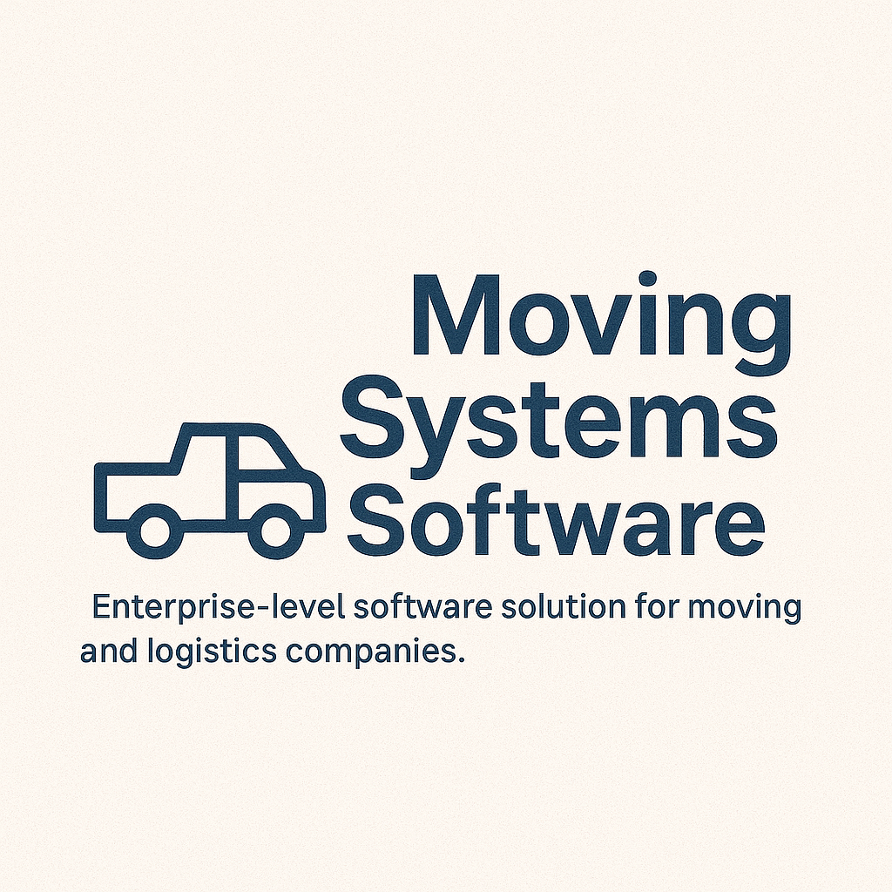

# Moving Systems

<div align="center">
  
</div>

## About

Moving Systems is a comprehensive web application designed to streamline and manage moving operations. Built with modern technologies, this platform provides a robust foundation for managing moving services, customer relationships, and operational workflows.

## Technology Stack

### Backend
- **Spring Boot** - Java-based application framework
- **Spring Security** - Authentication and authorization
- **Spring Data JPA** - Data persistence layer
- **Hibernate** - Object-relational mapping
- **Liquibase** - Database migration and versioning
- **Maven** - Build automation and dependency management

### Frontend
- **AngularJS** - JavaScript framework for dynamic web applications
- **Bootstrap** - Responsive UI framework
- **Gulp** - Build system and task automation
- **Bower** - Frontend package management

### Development & Testing
- **JHipster** - Application generator and scaffolding
- **Karma & Jasmine** - JavaScript testing framework
- **Gatling** - Performance testing
- **Jenkins** - Continuous Integration

## Prerequisites

Before you can build this project, you must install and configure the following dependencies on your machine:

1. **[Node.js][]** (v4.3+) - Required for frontend build tools and development server
2. **[Java 8+][]** - Required for Spring Boot application
3. **[Maven][]** - Build automation (included with project via Maven wrapper)

## Quick Start

### 1. Install Dependencies

Install Node.js dependencies (including Bower and Gulp):

```bash
npm install
```

### 2. Start Development Environment

Run the following commands in two separate terminals for a complete development experience:

**Terminal 1 - Backend Server:**
```bash
./mvnw
```

**Terminal 2 - Frontend Development Server:**
```bash
gulp
```

The application will be available at:
- **Local**: http://127.0.0.1:8080
- **External**: http://[your-ip]:8080

## Development Workflow

### Frontend Development
- **Auto-refresh**: Browser automatically refreshes when files change
- **Live reload**: CSS changes are applied instantly
- **Build optimization**: Gulp handles concatenation, minification, and optimization

### Backend Development
- **Hot reload**: Spring Boot DevTools enable automatic restart on code changes
- **Database migrations**: Liquibase manages schema changes
- **Profile management**: Separate configurations for dev, prod, and cloud environments

## Building for Production

To create an optimized production build:

```bash
./mvnw -Pprod clean package
```

This will:
- Concatenate and minify CSS and JavaScript files
- Optimize images and assets
- Generate a production-ready WAR file

### Running Production Build

```bash
java -jar target/*.war
```

Navigate to [http://localhost:8080](http://localhost:8080) to access the application.

## Testing

### Unit Tests
JavaScript unit tests are located in `src/test/javascript/` and can be run with:

```bash
gulp test
```

### Performance Tests
Gatling performance tests are located in `src/test/gatling` and can be run with:

```bash
./mvnw gatling:execute
```

## Project Structure

```
movingsystems/
├── src/
│   ├── main/
│   │   ├── java/com/movingsystems/    # Backend Java code
│   │   ├── resources/                 # Configuration files
│   │   └── webapp/                    # Frontend Angular application
│   └── test/                          # Test files
├── Moving_Systems_logo.png            # Project logo
├── README.md                          # This file
└── package.json                       # Node.js dependencies
```

## Configuration

### Application Profiles
- **dev**: Development environment with hot reload and debugging
- **prod**: Production environment with optimizations
- **cloud**: Cloud deployment configuration

### Key Configuration Files
- `src/main/resources/config/application.yml` - Main application configuration
- `src/main/resources/config/application-dev.yml` - Development-specific settings
- `src/main/resources/config/application-prod.yml` - Production-specific settings

## Continuous Integration

The project includes Jenkins configuration for automated builds:

- **Project name**: `movingsystems`
- **Build triggers**: Poll SCM every 5 minutes
- **Build steps**: Maven production build
- **Post-build**: JUnit test result publishing

## Contributing

1. Fork the repository
2. Create a feature branch (`git checkout -b feature/amazing-feature`)
3. Commit your changes (`git commit -m 'Add amazing feature'`)
4. Push to the branch (`git push origin feature/amazing-feature`)
5. Open a Pull Request

## Support

For questions and support:
- Check the [JHipster documentation](https://jhipster.github.io/)
- Review the application logs
- Contact the development team

## License

This project is proprietary software developed for Moving Systems.

---

<div align="center">
  <em>Built with ❤️ using JHipster</em>
</div>

[JHipster]: https://jhipster.github.io/
[Gatling]: http://gatling.io/
[Node.js]: https://nodejs.org/
[Bower]: http://bower.io/
[Gulp]: http://gulpjs.com/
[BrowserSync]: http://www.browsersync.io/
[Karma]: http://karma-runner.github.io/
[Jasmine]: http://jasmine.github.io/2.0/introduction.html
[Protractor]: https://angular.github.io/protractor/
[Java 8+]: https://www.oracle.com/java/technologies/javase-downloads.html
[Maven]: https://maven.apache.org/
